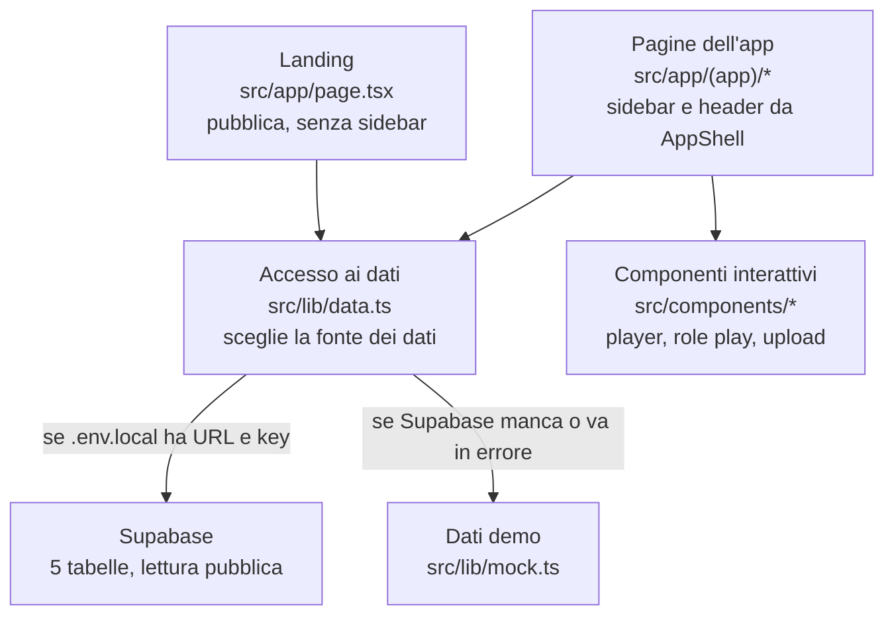

# Coach — Documentazione del team

Aggiornato al 24 ottobre 2026 · Matteo, Salvatore

## Stato del progetto

L'app demo di Coach gira in locale: landing, layout SaaS e 7 pagine navigabili anche da telefono. Il codice è sul branch `main` del repository `forbes-vibecoding-hackathon` (primo commit `bd692b3`). Non è ancora online e non è ancora collegata a Supabase: oggi mostra dati demo.

| Area | Stato | Note |
| --- | --- | --- |
| Scaffold Next.js 15 + Tailwind 4 | Fatto | Build, typecheck e lint verdi |
| Layout con sidebar e header | Fatto | Su telefono la sidebar diventa un menu a scomparsa |
| Pagine dell'app (Dashboard, Contenuti, Impara, Role play, Report, Team) | Fatto | Dati demo, interazioni simulate |
| Landing page | Fatto | Header con Piano, Numeri e Social, i quattro numeri del piano, prezzo col pilota |
| Schema Supabase e dati demo | Pronto, non applicato | File SQL nel repository |
| Collegamento a Supabase | Bloccato | Il connettore vede solo l'organizzazione Nutrime, non Forbes Vibecoding Hackathon |
| Pubblicazione su Vercel | Da fare | Serve il link da incollare nel foglio delle squadre |
| Piano di go to market (ICP, prezzo, imbuto, CAC, LTV, ROI, budget, canali, Fondimpresa) | Fatto | Pagina `/piano`. Tutti i numeri stanno in `src/lib/gtm.ts`, con la fonte (manuale dei casi) o scritti come ipotesi |
| Contenuti social (post e video) | Da fare | Vanno nella pagina `/social` |
| Visual (logo, avatar, mockup telefono) | Da fare | Dal team design, vedi [`DESIGN_BRIEF.md`](DESIGN_BRIEF.md) |

**Blocco aperto:** per collegare Supabase serve ri-autorizzare il connettore includendo l'organizzazione Forbes, oppure passare URL e anon key del progetto `forbes-vibecoding-hackathon`.

## Come avviare il progetto

Serve Node 20 o superiore: il progetto usa Node 24 (file `.nvmrc`). Su alcuni Mac Node parte di default alla versione 14, che non funziona con Next.js.

1. Clona il repository ed entra nella cartella.
2. Attiva Node 24: `nvm use`.
3. Installa le dipendenze: `npm install`.
4. Avvia: `npm run dev`, poi apri `http://localhost:3000` (la landing) o `/dashboard` (l'app).
5. Prima di un push controlla: `npm run build` e `npm run lint`.

Senza il file `.env.local` l'app usa i dati demo di `src/lib/mock.ts`: si può lavorare all'interfaccia anche senza Supabase. Per collegarlo, copia `.env.example` in `.env.local` e inserisci URL e anon key del progetto.

## Struttura del codice

Next.js 15 con App Router, Tailwind 4 e Supabase. Le pagine non parlano mai direttamente con il database: chiedono i dati a `src/lib/data.ts`, che usa Supabase se configurato e altrimenti i dati demo.

Le pagine dentro `src/app/(app)/` ereditano sidebar e header da `src/app/(app)/layout.tsx`; la landing resta fuori, a schermo pieno. Le voci della sidebar stanno in `src/components/nav.ts`, i componenti grafici comuni in `src/components/ui.tsx`, i colori in `src/app/globals.css`.

## Pagine e funzioni

Le pagine seguono i 4 passi del prodotto: Carica → Impara → Allenati → Migliora. Le interazioni sono simulate: la demo deve sembrare vera, non serve un'AI collegata.

| Pagina | URL | Per chi | Funzioni principali | File |
| --- | --- | --- | --- | --- |
| Landing | `/` | Giuria, chi compra | Promessa, 4 passi, per chi, prezzo (pilota 1.900 €, poi 19 €/persona/mese, ipotesi), il piano in quattro numeri | `src/app/page.tsx` |
| Piano | `/piano` | Giuria | Numeri (CAC, LTV, ROI, metrica guida), ICP, proposta di valore, prezzo, imbuto, budget da 50.000 €, canali, Fondimpresa, calendario | `src/app/piano/page.tsx`, `src/lib/gtm.ts` |
| Dashboard | `/dashboard` | HR, manager | 4 KPI, ore di pratica a settimana, competenze, ultimi role play, chi migliora, esporta in Excel | `src/app/(app)/dashboard/page.tsx` |
| Contenuti | `/contenuti` | HR, esperti | Caricamento documento con elaborazione animata, lista documenti e stato | `src/app/(app)/contenuti/page.tsx` |
| Impara | `/impara` | Dipendente | Docente AI con capitoli e audio animato, "Interrompi e chiedi" in chat | `src/components/lesson-player.tsx` |
| Role play | `/roleplay` | Dipendente | Scenari per area, ruolo dell'avatar, difficoltà, competenze | `src/app/(app)/roleplay/page.tsx` |
| Sessione | `/roleplay/[id]` | Dipendente | Videochiamata con avatar, timer, trascrizione in tempo reale, competenze spuntate | `src/components/roleplay-room.tsx` |
| Report | `/report/[id]` | Dipendente, manager | Voto del coach, punteggio per competenza, riscontro al minuto, prossimo allenamento | `src/app/(app)/report/[id]/page.tsx` |
| Team | `/team` | HR, manager | Tabella dei progressi per persona, esporta in Excel | `src/app/(app)/team/page.tsx` |

Percorso consigliato per la presentazione da 90 secondi: landing → Prova un role play → Termina e ricevi il voto → Dashboard → `/piano` (si apre sui numeri).

## Dati e Supabase

Lo schema ha 5 tabelle in sola lettura pubblica (RLS attiva, nessun login): per la demo basta leggere. I dati demo sono gli stessi in `src/lib/mock.ts` e in `supabase/seed.sql`.

| Tabella | Contiene | Collegata a |
| --- | --- | --- |
| `members` | Dipendenti: ruolo, area, livello, minuti di pratica, role play, punteggio, trend | — |
| `documents` | Documenti caricati: tipo, stato, numero di lezioni | — |
| `lessons` | Lezioni del docente AI, con capitoli e progresso | `documents` |
| `scenarios` | Scenari di role play: avatar, area, difficoltà, competenze | — |
| `sessions` | Role play svolti: voto, punteggi per competenza, riscontro al minuto (JSON) | `scenarios`, `members` |

**Per collegare il progetto `forbes-vibecoding-hackathon`:**

1. Esegui `supabase/migrations/20261024000000_init.sql` nell'editor SQL di Supabase.
2. Esegui `supabase/seed.sql`.
3. Metti URL e anon key in `.env.local` (in locale) e nelle variabili d'ambiente di Vercel.

**Se cambiate i dati demo:** modificate `src/lib/mock.ts`, poi rigenerate il seed con `npx tsx scripts/gen-seed.ts`. Così app e database restano allineati.

## Come lavoriamo

Abbiamo due ore e quattro persone: lavoriamo su file diversi e facciamo commit piccoli e frequenti su `main`, così nessuno resta indietro.

| Ruolo | Di cosa si occupa | Dove lavora |
| --- | --- | --- |
| Sviluppo | App, collegamento Supabase, pubblicazione su Vercel | `src/`, `supabase/` |
| Design | Colori, logo, avatar, mockup | `src/app/globals.css`, `public/` |
| Strategia | ICP, prezzo, imbuto, CAC, LTV, ROI, budget da 50.000 euro, canali | Testi per la landing |
| Contenuti | Post e video social pronti da pubblicare | Testi e immagini per la landing |

**Regole:**

- Prima di ogni push: `git pull`, poi `npm run build`. Se la build fallisce, non si fa push.
- Messaggi di commit in italiano, brevi, che dicono cosa cambia ("Aggiunge sezione budget alla landing").
- Colori e stili si cambiano solo dai token in `src/app/globals.css`, mai con codici colore sparsi nelle pagine.
- I testi dell'interfaccia sono in italiano, con frasi brevi e concrete.
- Ogni numero che non viene da una fonte si scrive come ipotesi.
- Questo file si aggiorna nello stesso commit della modifica che descrive.

**Come aggiungere una pagina all'app:**

1. Crea `src/app/(app)/<nome>/page.tsx`: eredita sidebar e header in automatico.
2. Aggiungi la voce in `src/components/nav.ts` (etichetta, icona di `lucide-react`, passo del prodotto).
3. Usa i componenti di `src/components/ui.tsx`: `Card`, `PageHeader`, `Badge`, `Button`, `Progress`, `ScorePill`, `Avatar`.
4. Se servono dati, aggiungi una funzione in `src/lib/data.ts`, con i dati demo in `src/lib/mock.ts`.

## Checklist di consegna

Allo scadere delle due ore si incolla il link del sito nel foglio delle squadre; dopo non si cambia più niente. La giuria valuta 4 criteri con lo stesso peso: il sito funziona, i contenuti si usano, i numeri reggono, i canali sono motivati.

- [x] Landing page del prodotto, vibecodata
- [x] Demo dell'app che sembra vera e si apre da telefono
- [ ] Sito online su Vercel, con il link
- [x] Strategia di go to market digitale e fisica, con le scelte motivate
- [x] Budget da 50.000 euro diviso voce per voce, con la somma che torna
- [x] ICP, proposta di valore, prezzo, imbuto con percentuali
- [x] CAC, LTV (almeno 3 volte il CAC), ROI iniziale, metrica guida
- [x] Canali di vendita: da chi passiamo per arrivare all'azienda (es. Fondimpresa, consulenti della formazione)
- [ ] Post e video social pronti da pubblicare, dentro il sito
- [x] Ogni numero senza fonte segnato come ipotesi
- [ ] Prova completa da telefono prima della consegna
- [ ] Link incollato nel foglio delle squadre

In presentazione: 90 secondi cronometrati, si apre il sito e si va dritti ai numeri.

## Registro delle modifiche

Aggiungete una riga in cima a ogni modifica importante.

| Data | Cosa | Chi |
| --- | --- | --- |
| 24 ott 2026 | Pagina `/piano` col piano di go to market, numeri in `src/lib/gtm.ts`, landing con header comune e prezzo col pilota | Salvatore |
| 24 ott 2026 | Skill di Claude in `.claude/skills` | Salvatore |
| 24 ott 2026 | Documentazione del team spostata in `docs/TEAM.md` | Matteo |
| 24 ott 2026 | Brief per il team design (`DESIGN_BRIEF.md`) e questa documentazione | Matteo |
| 24 ott 2026 | Setup Next.js + Supabase, layout SaaS, 7 pagine demo, schema e seed SQL (commit `bd692b3`) | Matteo |
